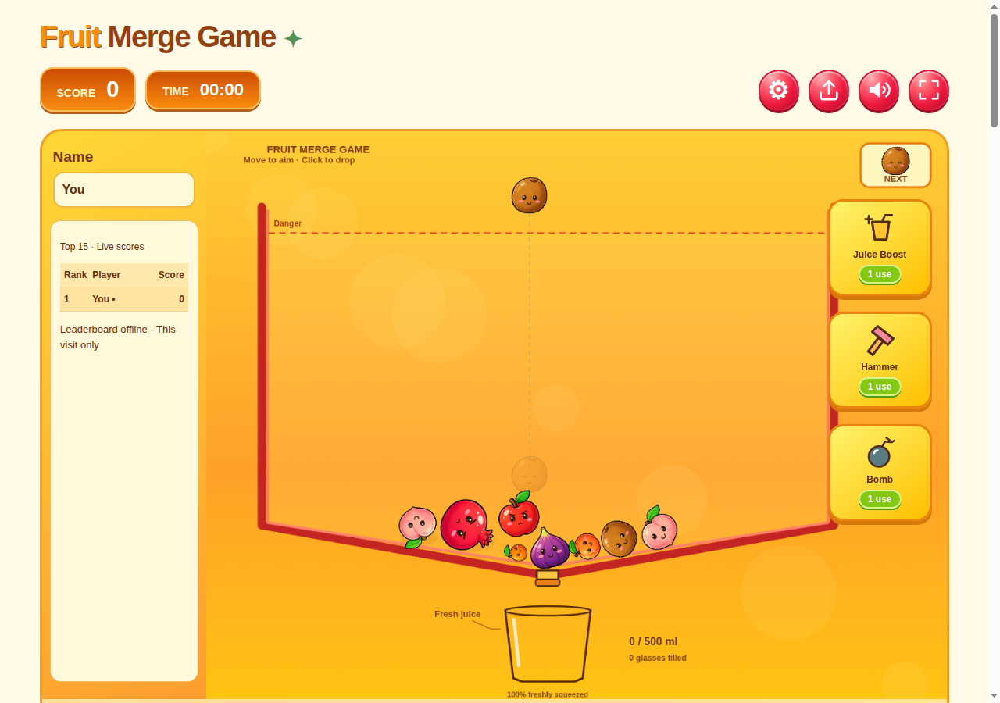

# Fruit Merge Game

A free browser merge game: drop fruits into the bowl, merge matches, and try to reach the watermelon.

**[Play Fruit Merge online](https://fruitmergegame.net/)**

- [Fruit Merge Unblocked](https://fruitmergegame.net/fruit-merge-game-unblocked/)
- [Fruit Merge Strategy Guide](https://fruitmergegame.net/fruit-merge-game-strategy/)

Fruit Merge is a free browser game. Drop fruits into the bowl, merge two identical ones into the next fruit along that line, and try to reach the watermelon. Keep the stack below the danger line — fruit that stays above it ends the run.



## Features

- Twenty-five fruits on four merge lines. A pair of the largest fruit on a line is squeezed into juice. Watermelon is the top of its line.
- Aim with the pointer or the arrow keys, then click or press Space to drop. On a touch screen, drag and release.
- A danger timer starts when fruit rests above the dashed line. Clear the top before it runs out.
- Three tools, once each per run: Juice Boost (double juice on the next three merges), Hammer (remove one fruit), and Bomb (clear fruit around a point).
- Score, run timer, juice, and a best score kept in the browser.
- A share card with your name and score, plus links for X, Facebook, and WhatsApp.
- Optional shared top 15 when a leaderboard server is running on the same origin. Without it, the game still plays and the board shows as offline.

## Tech stack

This is a pure front-end mini game. The playable page is static HTML, CSS, and JavaScript, drawn on a Canvas. There is no framework, no bundler, and no package install required to play.

Physics, drops, and merges live in `engine.js`. Faces and the fruit sprite sheet are drawn in `fruits.js`. Music and sound effects are synthesized in the browser with the Web Audio API; the repository does not include audio files.

An optional leaderboard is `fruit-merge-en-v11/server/leaderboard.py`. It uses only the Python standard library, stores scores in SQLite, and listens on localhost so it is not exposed directly. The static game does not need it.

`build.py` (also Python standard library only) rebuilds the offline previews and the `site/` directory from the template and `content/` files.

## Run locally

From a fresh clone, with Python 3:

```bash
cd fruit-merge-en-v11
python3 -m http.server 8080
```

Open [http://127.0.0.1:8080/](http://127.0.0.1:8080/). Serve this directory so the fruit sprites at `/assets/` load. Opening `index.html` as a `file://` URL will not.

Click or press Space to drop the fruit under the pointer. The first click also unlocks audio if you turn music on.

To play and keep a local shared board in one process:

```bash
cd fruit-merge-en-v11
python3 server/leaderboard.py --host 127.0.0.1 --port 43124 \
  --db /tmp/fruitmerge-scores.sqlite --static .
```

Then open [http://127.0.0.1:43124/](http://127.0.0.1:43124/). Finished runs can be posted to `POST /api/leaderboard`. The process refuses to bind anything except localhost.

`Fruit-Merge-Game-English.html` is a single-file preview with the scripts and images embedded. It is for reading the page offline; the HTTP server above is the way to play the real files.

## Project structure

```
fruit-merge-en-v11/
  index.html                 local preview (relative links)
  index.template.html        homepage source used by build.py
  game.js, engine.js, fruits.js, audio.js, share.js, leaderboard.js, style.css
  content/                   article, strategy, unblocked, FAQ, how-to
  assets/                    fruit sprites, share images
  rankings/                  top-15 frame
  site/                      static files for fruitmergegame.net
  server/leaderboard.py      optional localhost score API
  build.py                   rebuilds site/ and the previews
  tests/                     engine, content, and leaderboard checks
```

`python3 build.py` rewrites `site/`, `index.html`, and `Fruit-Merge-Game-English.html` from the template and `content/`. Edit those sources. A change made only under `site/` is lost the next time the build runs. The homepage footer is the footer in `index.template.html`.

GitHub Actions (`.github/workflows/static.yml`) runs that build and uploads `site/` to GitHub Pages.

## Tests

No install step. From `fruit-merge-en-v11`:

```bash
python3 tests/leaderboard_api.test.py
```

`node tests/run.cjs` and `python3 tests/content.test.py` are the engine, UI, and page checks. A fresh run is not all green: a few engine assertions still describe an older, narrower bowl, and the content check still expects two JSON-LD blocks on `site/index.html`, which has three. That mismatch is already on `main`.

## License

[MIT](LICENSE). Copyright (c) 2026 Nina.

The code, fruit sprites, and share art in this repository are covered by that license. A few details so the grant is not read more broadly than the files allow:

- No font files and no sound recordings are included. The page asks the browser for system fonts (Trebuchet MS, Arial, ui-rounded, and PingFang SC on the canvas). Missing ones fall back to a generic sans-serif.
- Music and effects are generated in `audio.js`. Nothing is sampled from a recording.
- `assets/fruit-bodies.png`, `assets/fruit-merge-banner.png`, and `assets/share-template.png` were generated as images for this project (C2PA metadata marks them as algorithmic-media output). `assets/qr.png` encodes `https://fruitmergegame.net/` and was drawn for the share card. ReportLab is not vendored. See `fruit-merge-en-v11/assets/ARTWORK-NOTES.md`.
- The Nick Launches badge on the homepage is a remote image, not a file in this repo.

Nothing in the tree carries a separate non-MIT license. The generated images are released here under MIT together with the code; that does not change whatever terms applied when those images were created.

## Contributing

Issues and pull requests are welcome. Please describe the behavior you expected and what the game did instead.

For gameplay or copy changes, edit the JavaScript, `index.template.html`, `style.css`, or `content/`, then run `python3 build.py` if you need a fresh `site/` directory. `python3 tests/leaderboard_api.test.py` covers the optional score API.
